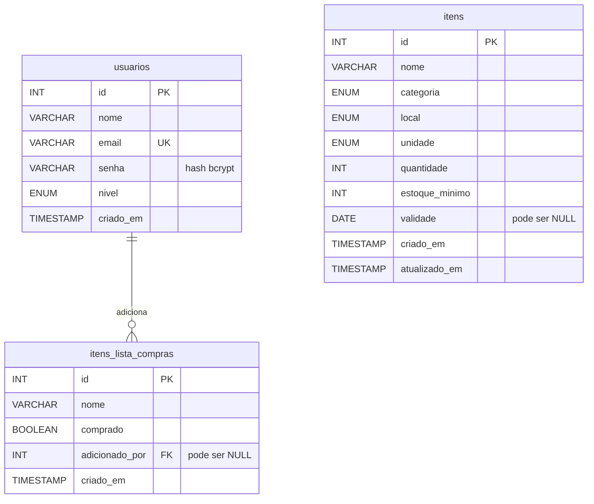

# Despensa em Dia — Planejamento Técnico (Entrega 2)

Este documento atualiza a [proposta da Entrega 1](PROPOSTA.md) com o que passou a existir de
verdade: banco de dados MySQL, API e integração do aplicativo.

```text
React Native  →  fetch()  →  API Express  →  MySQL
(screens/)      (services/)    (backend/)     (database/)
```

## 1. Requisitos funcionais atualizados

| Código | Requisito                                                    | Situação nesta entrega                    |
| ------ | ------------------------------------------------------------ | ----------------------------------------- |
| RF01   | Listar os itens do estoque, com busca e filtro por categoria | ✅ dados do MySQL (`GET /itens`)           |
| RF02   | Ver os detalhes de um item                                   | ✅ dados do MySQL                          |
| RF03   | Cadastrar item                                               | ✅ grava no MySQL (`POST /itens`)          |
| RF04   | Editar item                                                  | ✅ grava no MySQL (`PUT /itens/:id`)       |
| RF05   | Excluir item                                                 | ✅ grava no MySQL (`DELETE /itens/:id`)    |
| RF06   | Registrar consumo ("Usei 1")                                 | ✅ grava no MySQL (`PATCH /itens/:id/consumo`) |
| RF07   | Painel com alertas de validade e de estoque baixo            | ✅ calculado a partir dos dados do MySQL   |
| RF08   | Atualizar o estoque para ver mudanças de outros moradores    | ✅ novo: botão na tela Estoque             |
| RF09   | Avisar quando a API não responde e permitir tentar de novo   | ✅ novo                                    |
| RF10   | Lista de compras com sugestões automáticas                   | 🟡 tabela pronta; tela ainda em memória    |
| RF11   | Cadastro e login de usuários                                 | 🟡 tabela pronta; ainda simulado (Entrega 3) |
| RF12   | Gerenciar membros e níveis de acesso                         | 🟡 tabela pronta; ainda simulado (Entrega 3) |
| RF13   | Permissões garantidas no back-end com JWT                    | ⏳ Entrega 3                               |

## 2. Telas e fluxos atualizados

A navegação continua a mesma da proposta. O que mudou foi a origem dos dados:

| Tela             | Origem dos dados        | O que mudou nesta entrega                                 |
| ---------------- | ----------------------- | --------------------------------------------------------- |
| Login            | Memória (simulado)      | Depois de entrar, o app busca os itens na API             |
| Criar conta      | Memória (simulado)      | —                                                         |
| Início           | API + memória           | Mostra "carregando" ou o erro em vez de números falsos    |
| Estoque          | API                     | Novo botão "Atualizar estoque"                            |
| Detalhes do item | API                     | "Usei 1" e "Excluir" aguardam a confirmação da API        |
| Novo/Editar item | API                     | Botão "Salvando…" e mensagens de erro enviadas pela API   |
| Lista de compras | Memória                 | Sugestões usam os itens da API                            |
| Família          | Memória (simulado)      | —                                                         |

### Fluxo ao salvar um item

```text
FormularioItem: valida os campos
      │  salvarItem (recebida por Props do App.js)
      ▼
services/api.js: fetch('POST /itens')
      │
      ▼
API: validarItem ── dados inválidos ──► 400 { mensagem } ──► a tela mostra o erro
      │ dados válidos
      ▼
INSERT no MySQL ──► 201 { mensagem, item } ──► App.js atualiza a lista ──► volta para a tela anterior
```

Se a API não responder em 10 segundos, ou se estiver desligada, a tela mostra o aviso e nada é
alterado. A lista só muda depois da confirmação da API, para o app nunca mostrar algo que não foi salvo.

## 3. Estrutura do banco de dados

O script completo está em [database/despensa_em_dia.sql](../database/despensa_em_dia.sql).



## 4. Entidades e campos

### `itens` (entidade principal)

| Campo            | Tipo                     | Regra                                                  |
| ---------------- | ------------------------ | ------------------------------------------------------ |
| `id`             | INT, chave primária      | Gerado pelo banco                                      |
| `nome`           | VARCHAR(120)             | Obrigatório, de 2 a 120 caracteres                     |
| `categoria`      | ENUM                     | Alimentos, Bebidas, Limpeza ou Higiene                 |
| `local`          | ENUM                     | Armário, Geladeira, Freezer, Lavanderia ou Banheiro    |
| `unidade`        | ENUM                     | un, pacote, caixa, kg, litro ou garrafa                |
| `quantidade`     | INT                      | Inteiro, nunca negativo (`CHECK`)                      |
| `estoque_minimo` | INT                      | Inteiro, nunca negativo (`CHECK`)                      |
| `validade`       | DATE, opcional           | `NULL` para itens sem validade                         |
| `criado_em`      | TIMESTAMP                | Preenchido pelo banco                                  |
| `atualizado_em`  | TIMESTAMP                | Atualizado pelo banco a cada alteração                 |

### `usuarios`

| Campo       | Tipo                  | Regra                                             |
| ----------- | --------------------- | ------------------------------------------------- |
| `id`        | INT, chave primária   | Gerado pelo banco                                 |
| `nome`      | VARCHAR(100)          | Obrigatório                                       |
| `email`     | VARCHAR(150), único   | Não pode repetir                                  |
| `senha`     | VARCHAR(255)          | Somente o hash bcrypt, nunca a senha original     |
| `nivel`     | ENUM                  | `responsavel` ou `membro`; o padrão é `membro`    |
| `criado_em` | TIMESTAMP             | Preenchido pelo banco                             |

### `itens_lista_compras`

| Campo            | Tipo                  | Regra                                                     |
| ---------------- | --------------------- | --------------------------------------------------------- |
| `id`             | INT, chave primária   | Gerado pelo banco                                         |
| `nome`           | VARCHAR(120)          | Texto livre: nem tudo que se compra já está no estoque    |
| `comprado`       | BOOLEAN               | Começa como falso                                         |
| `adicionado_por` | INT, chave estrangeira | Aponta para `usuarios`; vira `NULL` se a conta for removida |
| `criado_em`      | TIMESTAMP             | Preenchido pelo banco                                     |

**Escopo:** o sistema atende a uma casa por instalação, por isso não há tabela de famílias.

## 5. Principais rotas da API

### Já implementadas

| Método e rota              | O que faz                      | Respostas                    |
| -------------------------- | ------------------------------ | ---------------------------- |
| `GET /`                    | Identifica a API               | 200                          |
| `GET /status`              | Confere a conexão com o banco  | 200, 500                     |
| `GET /itens`               | Lista os itens por nome        | 200                          |
| `GET /itens/:id`           | Busca um item                  | 200, 400, 404                |
| `POST /itens`              | Cadastra um item               | 201, 400                     |
| `PUT /itens/:id`           | Atualiza um item               | 200, 400, 404                |
| `DELETE /itens/:id`        | Exclui um item                 | 200, 400, 404                |
| `PATCH /itens/:id/consumo` | Desconta 1 da quantidade       | 200, 400, 404, 409 (já acabou) |

Exemplo de corpo para `POST` e `PUT`:

```json
{
  "nome": "Café em pó",
  "categoria": "Alimentos",
  "local": "Armário",
  "unidade": "un",
  "quantidade": 2,
  "estoqueMinimo": 1,
  "validade": "2027-03-15"
}
```

Erros sempre têm o formato `{ "mensagem": "..." }`. Os valores entram nas consultas pelos
parâmetros `?`, sem concatenar texto no SQL, o que evita SQL Injection.

### Previstas para a Entrega 3

| Método e rota                     | O que fará                             |
| --------------------------------- | -------------------------------------- |
| `POST /auth/cadastro`             | Cria conta, sempre como `membro`       |
| `POST /auth/login`                | Confere o hash e devolve o JWT         |
| `GET /auth/me`                    | Devolve o usuário do token             |
| `GET /usuarios`                   | Lista os membros da casa               |
| `PATCH /usuarios/:id/nivel`       | Altera o nível de um membro            |
| `GET /lista-compras`              | Lista os produtos                      |
| `POST /lista-compras`             | Adiciona um produto                    |
| `PATCH /lista-compras/:id`        | Marca ou desmarca como comprado        |
| `DELETE /lista-compras/comprados` | Remove os produtos já comprados        |

## 6. Níveis de usuário e permissões previstas

| Operação                                        | Sem login | Membro | Responsável |
| ----------------------------------------------- | :-------: | :----: | :---------: |
| Criar conta e entrar                            |     ✅     |   ✅    |      ✅      |
| Consultar itens (`GET /itens`)                  |     ❌     |   ✅    |      ✅      |
| Registrar consumo (`PATCH /itens/:id/consumo`)  |     ❌     |   ✅    |      ✅      |
| Usar a lista de compras                         |     ❌     |   ✅    |      ✅      |
| Cadastrar, editar e excluir itens               |     ❌     |   ❌    |      ✅      |
| Listar membros e alterar níveis                 |     ❌     |   ❌    |      ✅      |

Na Entrega 3, os middlewares `autenticarToken` e `somenteResponsavel` vão garantir essa tabela
no servidor, lendo o nível atual no banco.

> ⚠️ **Situação atual:** nesta entrega a tabela acima é aplicada **apenas na tela**. As rotas de
> `/itens` ainda não exigem login, então qualquer pessoa na mesma rede pode chamá-las. Use a API
> somente em ambiente de desenvolvimento e sem dados reais até a conclusão da Entrega 3.
